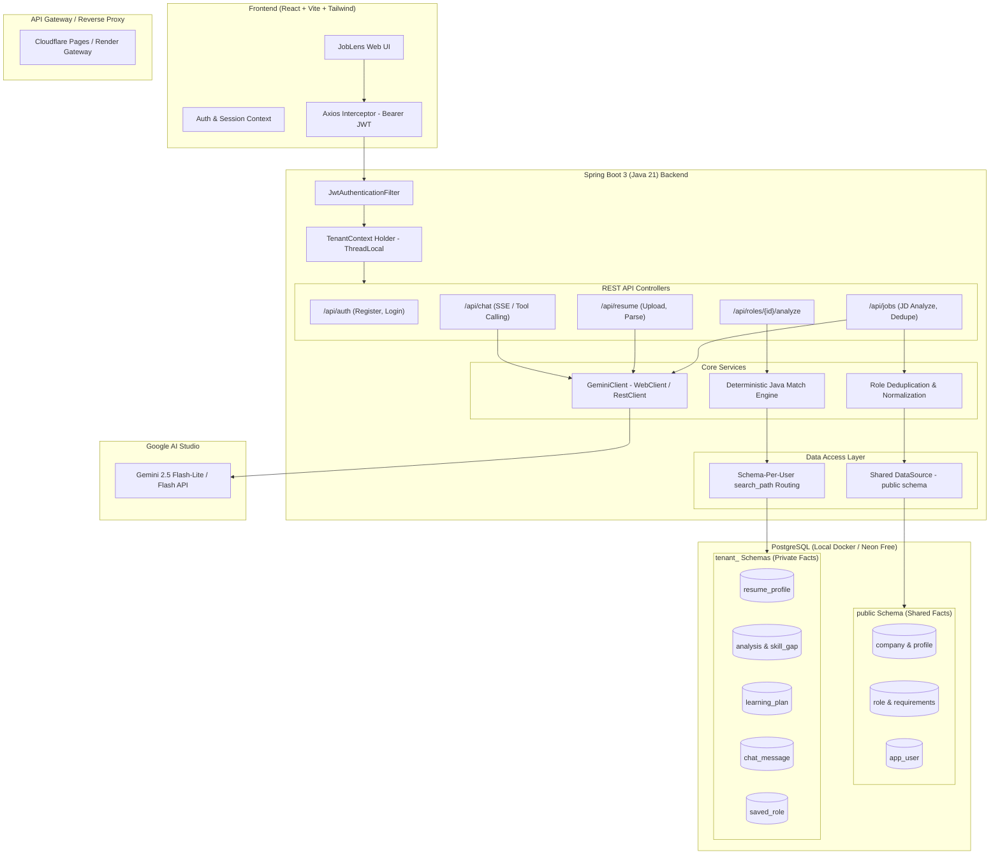

# JobLens Architecture & System Design

JobLens is an AI-powered engineering career intelligence platform tailored for Sri Lankan fresh engineering graduates. It allows graduates to upload or paste job descriptions (JDs) and resumes, extract requirements, save them under a shared catalog (**Company → Role**), calculate skill gaps, produce personalized learning roadmaps, and chat with an AI assistant that reasons over their private career data.

---

## 1. System Overview & Monorepo Layout

```
joblens/
├── docker-compose.yml       # Local PostgreSQL 16 & pgAdmin 4
├── .env.example             # Environment template
├── README.md                # Project entrypoint
├── docs/                    # Architecture, ERD, setup & prompts
│   ├── ARCHITECTURE.md      # System architecture & tenant isolation
│   ├── ERD.md               # Shared vs Private database schemas
│   └── SETUP_GUIDE.md       # Local dev, Neon, and Gemini setup
├── backend/                 # Spring Boot 3 (Java 21) REST API
│   ├── src/main/java/lk/joblens/
│   │   ├── config/          # Security, Web, Multi-Tenant DataSource
│   │   ├── auth/            # Auth, JWT filter, TenantContext
│   │   ├── shared/          # Entities/repos for global catalog
│   │   ├── tenant/          # Entities/repos for private user data
│   │   ├── ai/              # GeminiClient, prompt templates, tools
│   │   ├── jobs/            # JD extraction, deduplication, matching
│   │   ├── analysis/        # Java match scoring, gap prioritization
│   │   ├── chat/            # Gemini function-calling chatbot
│   │   └── admin/           # Moderation queue
│   └── src/main/resources/
│       ├── application.yml  # Application properties
│       └── db/
│           ├── shared/      # Flyway migrations for public/shared schema
│           └── tenant/      # Flyway migrations for per-user tenant schemas
└── frontend/                # React (Vite + TypeScript + Tailwind)
    └── src/
        ├── api/             # Axios client & React Query hooks
        ├── components/      # UI components & design system
        ├── pages/           # Dashboard, Jobs, Resume, Chat, Admin
        ├── context/         # AuthContext & Tenant state
        └── types/           # Shared TypeScript interfaces
```

---

## 2. High-Level Architecture Diagram



---

## 3. Free-Tier Multi-Tenancy Strategy (Schema-Per-User)

Running individual PostgreSQL database clusters per user is impossible on a $0 budget. JobLens implements **schema-per-user multi-tenancy** inside a single PostgreSQL database instance (Neon Free / Local Docker):

1. **Shared Schema (`public`):**
   - Holds shared market catalog: companies, normalized roles, requirements, and the central `app_user` authentication registry.
   - Migrated at backend boot using Flyway targeting the `public` schema (`db/migration/shared`).

2. **Isolated Private Schemas (`tenant_<uuid>`):**
   - Each registered user receives their own PostgreSQL schema named `tenant_<user_id>`.
   - On registration, the backend executes:
     ```sql
     CREATE SCHEMA IF NOT EXISTS "tenant_abc123";
     ```
     and applies the Flyway migrations from `db/migration/tenant` against that schema.
   - When handling authenticated requests, `JwtAuthenticationFilter` extracts the user ID, sets `TenantContext.setCurrentTenant(tenantSchema)`, and Spring's DataSource config executes `SET search_path TO "tenant_abc123", public` or uses a routing DataSource.
   - **Zero cross-contamination:** User A can never query User B's tables because their connection is bound to their dedicated schema.

---

## 4. Cost Optimization & Gemini AI Guardrails ($0 Budget)

1. **Deterministic Java Match Scoring:**
   - Raw skill overlap calculations and weighted MUST vs NICE scoring are computed 100% in Java memory without spending AI tokens.
   - Gemini is invoked only for qualitative analysis and synthesis (explanation and learning roadmap).

2. **Deduplication First:**
   - Before extracting a JD with Gemini, the system computes a role fingerprint (`company_normalized + title_normalized + level`).
   - If the role already exists in the shared database, extraction is skipped entirely (0 AI cost), and the role's `seen_count` increments.

3. **Privacy Scrubbing:**
   - Resumes and JDs are scrubbed locally (regex stripping of names, phone numbers, emails, URLs) before sending prompts to the Gemini API.

4. **Model Selection:**
   - **Gemini 2.5 Flash-Lite / Gemini 2.0 Flash:** Used for extraction, parsing, and chat function calling.
   - Config-driven model name via `gemini.model` in `application.yml`.
