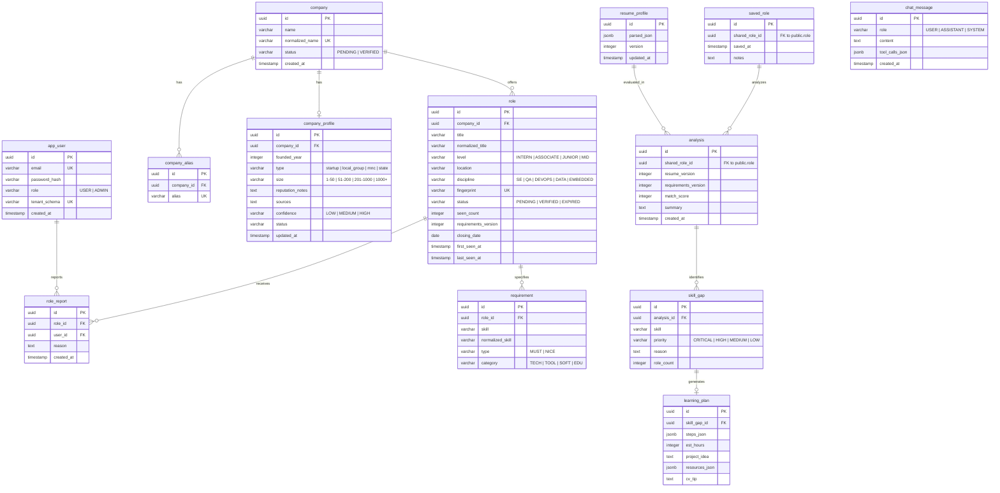

# JobLens Entity Relationship Diagram (ERD)

This document specifies the database schemas for JobLens, divided into **Shared Tables** (`public` schema) and **Private Tables** (isolated `tenant_<user_id>` schema per user).

---

## 1. Visual Schema Diagram

---

## 2. Shared Tables Schema (`public` schema)

These tables contain public facts contributed by all users, deduplicated and verified.

### `app_user`
| Column | Type | Constraints | Description |
|---|---|---|---|
| `id` | `UUID` | `PRIMARY KEY` | Global unique identifier |
| `email` | `VARCHAR(255)` | `UNIQUE, NOT NULL` | User email address |
| `password_hash` | `VARCHAR(255)` | `NOT NULL` | BCrypt password hash |
| `role` | `VARCHAR(50)` | `NOT NULL DEFAULT 'USER'` | `USER` or `ADMIN` |
| `tenant_schema` | `VARCHAR(100)` | `UNIQUE, NOT NULL` | Schema name, e.g. `tenant_a1b2c3d4` |
| `created_at` | `TIMESTAMPTZ` | `NOT NULL DEFAULT NOW()` | Creation timestamp |

### `company`
| Column | Type | Constraints | Description |
|---|---|---|---|
| `id` | `UUID` | `PRIMARY KEY` | Unique ID |
| `name` | `VARCHAR(255)` | `NOT NULL` | Display company name |
| `normalized_name` | `VARCHAR(255)` | `UNIQUE, NOT NULL` | Stripped/cleaned name |
| `status` | `VARCHAR(50)` | `NOT NULL DEFAULT 'PENDING'` | `PENDING` or `VERIFIED` |
| `created_at` | `TIMESTAMPTZ` | `NOT NULL DEFAULT NOW()` | First submission timestamp |

### `company_alias`
| Column | Type | Constraints | Description |
|---|---|---|---|
| `id` | `UUID` | `PRIMARY KEY` | Unique ID |
| `company_id` | `UUID` | `NOT NULL, REFERENCES company(id)` | Associated company |
| `alias` | `VARCHAR(255)` | `UNIQUE, NOT NULL` | Alternate spelling or trade name |

### `company_profile`
| Column | Type | Constraints | Description |
|---|---|---|---|
| `id` | `UUID` | `PRIMARY KEY` | Unique ID |
| `company_id` | `UUID` | `UNIQUE, NOT NULL, REFERENCES company(id)` | Associated company |
| `founded_year` | `INTEGER` | `NULL` | Year founded |
| `type` | `VARCHAR(50)` | `NULL` | Startup, Local Group, MNC, State-owned |
| `size` | `VARCHAR(50)` | `NULL` | Headcount band |
| `reputation_notes` | `TEXT` | `NULL` | Intelligence notes |
| `sources` | `TEXT` | `NULL` | Origin links / citations |
| `confidence` | `VARCHAR(50)` | `NOT NULL DEFAULT 'LOW'` | `LOW`, `MEDIUM`, `HIGH` |
| `status` | `VARCHAR(50)` | `NOT NULL DEFAULT 'PENDING'` | Moderation status |
| `updated_at` | `TIMESTAMPTZ` | `NOT NULL DEFAULT NOW()` | Last update timestamp |

### `role`
| Column | Type | Constraints | Description |
|---|---|---|---|
| `id` | `UUID` | `PRIMARY KEY` | Unique ID |
| `company_id` | `UUID` | `NOT NULL, REFERENCES company(id)` | Company offering the role |
| `title` | `VARCHAR(255)` | `NOT NULL` | Role title |
| `normalized_title`| `VARCHAR(255)` | `NOT NULL` | Cleaned title |
| `level` | `VARCHAR(50)` | `NOT NULL` | `INTERN`, `ASSOCIATE`, `JUNIOR`, `MID` |
| `location` | `VARCHAR(255)` | `NULL` | Location (e.g. Colombo, Remote) |
| `discipline` | `VARCHAR(100)` | `NOT NULL` | `SE`, `QA`, `DEVOPS`, `DATA`, etc. |
| `fingerprint` | `VARCHAR(255)` | `UNIQUE, NOT NULL` | SHA-256 hash for deduplication |
| `status` | `VARCHAR(50)` | `NOT NULL DEFAULT 'PENDING'` | `PENDING`, `VERIFIED`, `EXPIRED` |
| `seen_count` | `INTEGER` | `NOT NULL DEFAULT 1` | Submission count |
| `requirements_version` | `INTEGER` | `NOT NULL DEFAULT 1` | Increments on updates |
| `closing_date` | `DATE` | `NULL` | Application deadline |
| `first_seen_at` | `TIMESTAMPTZ` | `NOT NULL DEFAULT NOW()` | First submitted |
| `last_seen_at` | `TIMESTAMPTZ` | `NOT NULL DEFAULT NOW()` | Most recently submitted |

### `requirement`
| Column | Type | Constraints | Description |
|---|---|---|---|
| `id` | `UUID` | `PRIMARY KEY` | Unique ID |
| `role_id` | `UUID` | `NOT NULL, REFERENCES role(id)` | Associated role |
| `skill` | `VARCHAR(255)` | `NOT NULL` | Display skill name |
| `normalized_skill`| `VARCHAR(255)`| `NOT NULL` | Normalized canonical skill |
| `type` | `VARCHAR(20)` | `NOT NULL` | `MUST` or `NICE` |
| `category` | `VARCHAR(50)` | `NOT NULL` | `TECH`, `TOOL`, `SOFT`, `EDU` |

---

## 3. Private Tables Schema (`tenant_<user_id>` schema)

Each user gets their own private schema containing their personal career records.

### `resume_profile`
| Column | Type | Constraints | Description |
|---|---|---|---|
| `id` | `UUID` | `PRIMARY KEY` | Unique profile ID |
| `parsed_json` | `JSONB` | `NOT NULL` | Structured skills, education, projects |
| `version` | `INTEGER` | `NOT NULL DEFAULT 1` | Version incremented on edit |
| `updated_at` | `TIMESTAMPTZ` | `NOT NULL DEFAULT NOW()` | Last modified timestamp |

### `saved_role`
| Column | Type | Constraints | Description |
|---|---|---|---|
| `id` | `UUID` | `PRIMARY KEY` | Bookmark ID |
| `shared_role_id` | `UUID` | `NOT NULL` | Points to `public.role(id)` |
| `saved_at` | `TIMESTAMPTZ` | `NOT NULL DEFAULT NOW()` | Saved timestamp |
| `notes` | `TEXT` | `NULL` | User's private notes |

### `analysis`
| Column | Type | Constraints | Description |
|---|---|---|---|
| `id` | `UUID` | `PRIMARY KEY` | Analysis ID |
| `shared_role_id` | `UUID` | `NOT NULL` | Target role |
| `resume_version` | `INTEGER` | `NOT NULL` | Snapshot of resume version |
| `requirements_version`| `INTEGER` | `NOT NULL` | Snapshot of role requirements version |
| `match_score` | `INTEGER` | `NOT NULL` | Calculated score (0-100) |
| `summary` | `TEXT` | `NOT NULL` | AI synthesis summary |
| `created_at` | `TIMESTAMPTZ` | `NOT NULL DEFAULT NOW()` | Analysis timestamp |

### `skill_gap`
| Column | Type | Constraints | Description |
|---|---|---|---|
| `id` | `UUID` | `PRIMARY KEY` | Skill gap ID |
| `analysis_id` | `UUID` | `NOT NULL, REFERENCES analysis(id)` | Associated analysis |
| `skill` | `VARCHAR(255)` | `NOT NULL` | Missing skill name |
| `priority` | `VARCHAR(20)` | `NOT NULL` | `CRITICAL`, `HIGH`, `MEDIUM`, `LOW` |
| `reason` | `TEXT` | `NOT NULL` | Why this skill is critical |
| `role_count` | `INTEGER` | `NOT NULL DEFAULT 1` | Missing across N saved roles |

### `learning_plan`
| Column | Type | Constraints | Description |
|---|---|---|---|
| `id` | `UUID` | `PRIMARY KEY` | Learning plan ID |
| `skill_gap_id` | `UUID` | `NOT NULL, REFERENCES skill_gap(id)` | Associated skill gap |
| `steps_json` | `JSONB` | `NOT NULL` | 1-3 week step-by-step roadmap |
| `est_hours` | `INTEGER` | `NOT NULL` | Estimated hours |
| `project_idea` | `TEXT` | `NOT NULL` | Portfolio project concept |
| `resources_json`| `JSONB` | `NOT NULL` | Free curated learning resources |
| `cv_tip` | `TEXT` | `NOT NULL` | Resume bullet phrasing recommendation |

### `chat_message`
| Column | Type | Constraints | Description |
|---|---|---|---|
| `id` | `UUID` | `PRIMARY KEY` | Message ID |
| `role` | `VARCHAR(20)` | `NOT NULL` | `USER`, `ASSISTANT`, or `SYSTEM` |
| `content` | `TEXT` | `NOT NULL` | Message body |
| `tool_calls_json`| `JSONB` | `NULL` | Tool invocations & arguments |
| `created_at` | `TIMESTAMPTZ` | `NOT NULL DEFAULT NOW()` | Message timestamp |
